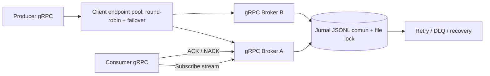

# Proiectul 2: Comunicare inter-servicii prin gRPC

Proiect Java pentru comunicarea Producer–Broker–Consumer folosind **gRPC peste HTTP/2** și
contracte **Protocol Buffers**. Include persistența mesajelor în fișiere JSONL, confirmarea livrării prin
ACK/NACK, mecanisme de retry și Dead Letter Queue (DLQ), deduplicarea mesajelor, gestionarea abonamentelor,
load balancing, recuperarea stării după restart, backup și restaurare. Proiectul include teste automate, diagrame d
e arhitectură și secvență, documentație ADR și scenarii de testare a erorilor.

## Arhitectură



Contractul se află în `src/main/proto/messaging.proto` și definește șase RPC-uri: `Publish`, `Subscribe` (
server-streaming), `Ack`, `Nack`, `Unsubscribe` și `GetStatus`.

## Funcționalități

- **Persistență durabilă:** evenimentele sunt adăugate în `data/messages.jsonl`; `FileChannel.force(true)` este apelat
  înainte de confirmarea publicării/ACK-ului. Starea se reconstruiește la restart prin replay-ul jurnalului.
- **ACK/NACK persistent:** confirmările și respingerile sunt scrise în jurnal.
- **Retry/backoff:** maximum 3 livrări, cu întârzieri exponențiale; după epuizare, mesajul ajunge în DLQ persistentă.
- **Deduplicare:** același `message_id` cu același conținut este idempotent; ID-ul reutilizat cu alt conținut este
  respins.
- **Abonamente persistente:** înregistrare la `Subscribe`, eliminare la anularea stream-ului sau prin `Unsubscribe`.
- **Load balancing client-side:** endpoint pool round-robin și failover la publicare între endpoint-uri configurate.
- **Backup periodic și restaurare:** copii JSONL în `data/backups`; restaurare configurabilă la pornire.
- **Teste:** teste dedicate jurnalului de fișiere în `src/test/java/md/utm/messaging/grpc/`.
- **Documentație:** ADR, diagramă de arhitectură și scenarii de eșec în `docs/`.

### Garanții și limite

Livrarea este **at-least-once**, nu exactly-once; un consumator poate primi din nou un mesaj dacă se oprește după
efectul local, dar înainte de ACK. Efectele consumatorului trebuie să fie idempotente. Load balancing-ul între instanțe
cere ca broker-ele să folosească aceeași cale absolută de jurnal pe un filesystem cu file-locking fiabil; acesta nu este
un protocol de replicare/consens distribuit. Opriți toate instanțele înainte de restaurarea unui backup. DLQ-ul este
persistent, însă nu există încă RPC administrativ pentru redrive din DLQ.

## Cerințe și rulare

Necesită JDK 17+ și Maven 3.9+.

```bash
mvn clean test
```

Porniți brokerul:

```bash
mvn exec:java -Dexec.mainClass="com.service.grpc.broker.GrpcBrokerApplication"
```

În terminal separat, publicați mesaje:

```bash
mvn exec:java -Dexec.mainClass="com.service.grpc.producer.GrpcProducerApplication"
```

Porniți consumer-ul:

```bash
mvn exec:java -Dexec.mainClass="com.service.grpc.consumer.GrpcConsumerApplication" -Dexec.args="consumer-1 orders normal"
```

Moduri de testare a eșecurilor: `always-nack` și `crash-before-ack`.

### Două instanțe pentru testarea load balancing-ului (Linux/macOS)

Rulați fiecare comandă într-un terminal separat, folosind aceeași cale absolută pentru jurnal:

```bash
GRPC_PORT=50051 MESSAGE_JOURNAL=/tmp/messaging/shared.jsonl mvn exec:java -Dexec.mainClass="com.service.grpc.broker.GrpcBrokerApplication"
GRPC_PORT=50052 MESSAGE_JOURNAL=/tmp/messaging/shared.jsonl mvn exec:java -Dexec.mainClass="com.service.grpc.broker.GrpcBrokerApplication"
GRPC_ENDPOINTS=127.0.0.1:50051,127.0.0.1:50052 mvn exec:java -Dexec.mainClass="com.service.grpc.producer.GrpcProducerApplication"
```

### Configurare

- `GRPC_PORT` — port broker, implicit `50051`.
- `GRPC_HOST` — host implicit al clientului, `127.0.0.1`.
- `GRPC_ENDPOINTS` — endpoint-uri separate prin virgulă, de exemplu `127.0.0.1:50051,127.0.0.1:50052`.
- `MESSAGE_JOURNAL` — calea jurnalului, implicit `data/messages.jsonl`.
- `MESSAGE_BACKUP_DIR` — director backup, implicit `data/backups`.
- `MESSAGE_BACKUP_INTERVAL_SECONDS` — interval backup, implicit `300`; `0` dezactivează backup-ul.
- `MESSAGE_RESTORE_FROM` — fișier JSONL de restaurat la pornire.

## Verificare înainte de predare

Arhiva conține codul și testele, dar testele trebuie rulate în mediul tău cu `mvn clean test`; nu presupune că au trecut
până când comanda nu se termină cu BUILD SUCCESS.

## Diagrame

- `docs/diagrams/architecture-grpc.md` — diagrama arhitecturii.
- `docs/diagrams/sequence-diagrams-grpc.md` — diagrame de secvență pentru publicare, consum/ACK/NACK/retry/DLQ,
  recuperare după restart, load balancing/failover și backup/restaurare.

## Diagrame

Vezi `docs/diagrams/diagrams-index.md` pentru indexul diagramelor. Diagramele descriu arhitectura și fluxurile țintă; confirmă comportamentul prin testele
automate înainte de predare.