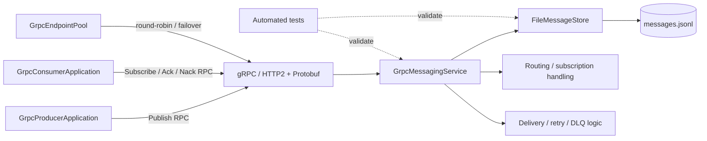

# Diagrama componentelor gRPC



## Responsabilități

- **Producer:** publică mesaje prin clientul gRPC.
- **Consumer:** se abonează, primește mesaje și trimite ACK/NACK.
- **gRPC API:** contractul tipizat definit în `src/main/proto/messaging.proto`.
- **GrpcMessagingService:** adaptează apelurile RPC la operațiile brokerului.
- **FileMessageStore:** jurnalizează datele necesare recuperării.
- **GrpcEndpointPool:** selectează endpoint-uri client-side și încearcă failover-ul configurat.

Notă: componentele prezentate sunt separări logice; o diagramă nu constituie dovadă că toate politicile de livrare sunt
implementate complet.

```