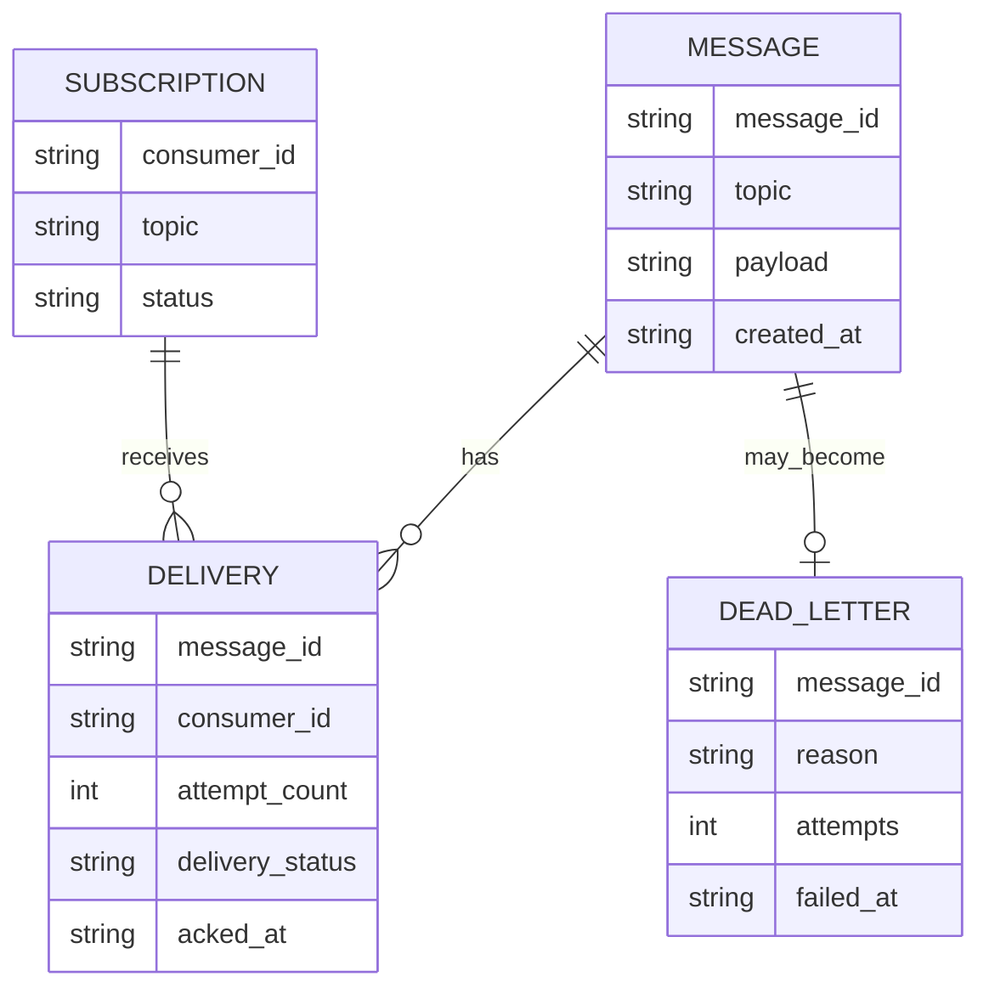

# Model logic al datelor persistate



Aceasta este schema logică pentru explicarea proiectului. Formatul fizic exact depinde de evenimentele serializate
efectiv de `FileMessageStore` în jurnalul JSONL.

```