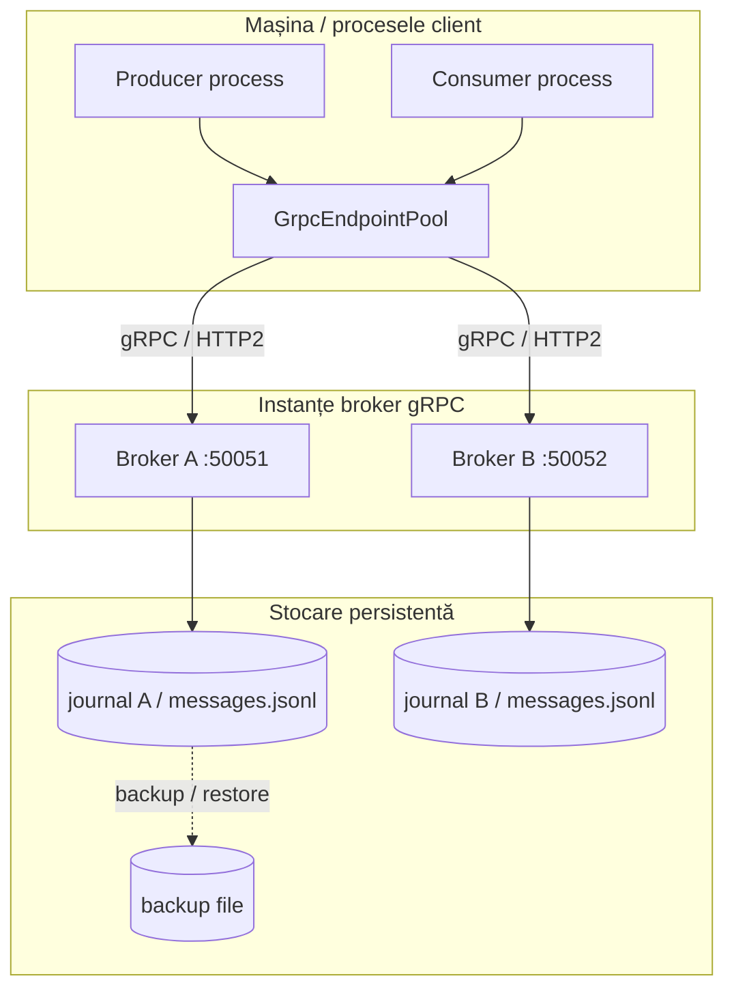

# Diagrama de deployment



## Note de deployment

- Portul implicit al brokerului este `50051`; instanțele suplimentare trebuie configurate cu porturi diferite.
- Endpoint-urile trebuie configurate explicit în client.
- Un jurnal local per instanță **nu** oferă replicare automată între brokeri. Dacă instanțele folosesc stocare separată,
  failover-ul poate ajunge la o instanță care nu are aceeași stare. Pentru consistență multi-broker este necesar un
  jurnal comun cu locking fiabil sau un protocol de replicare distribuită.
- Nu expuneți porturile în rețele neîncredere fără TLS și autentificare.

```