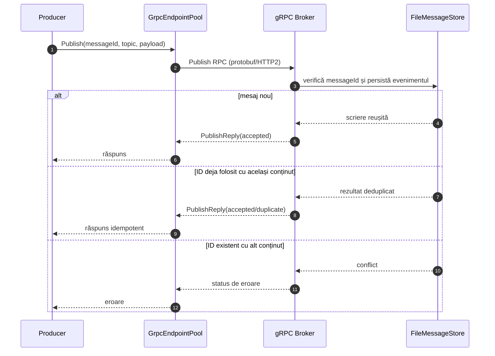
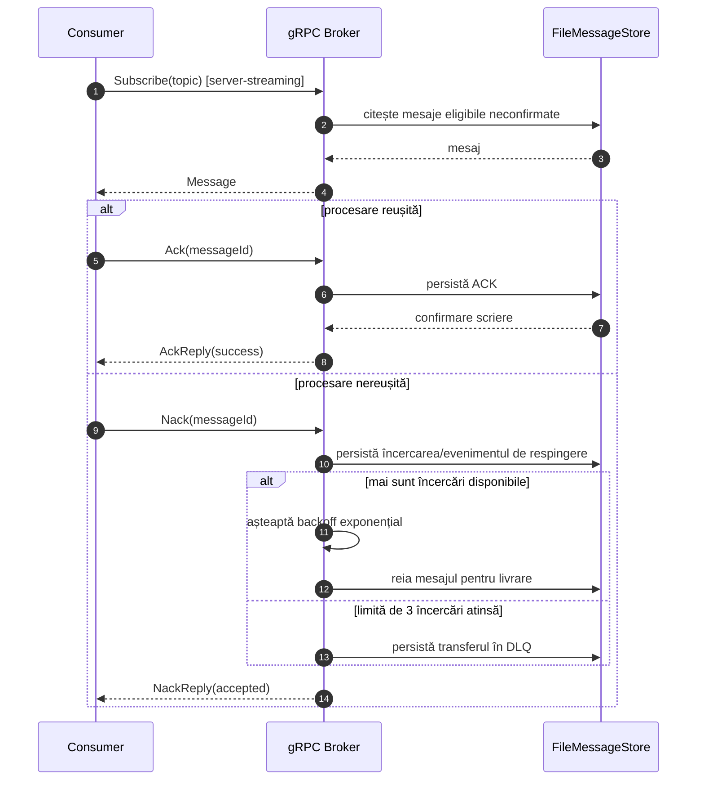
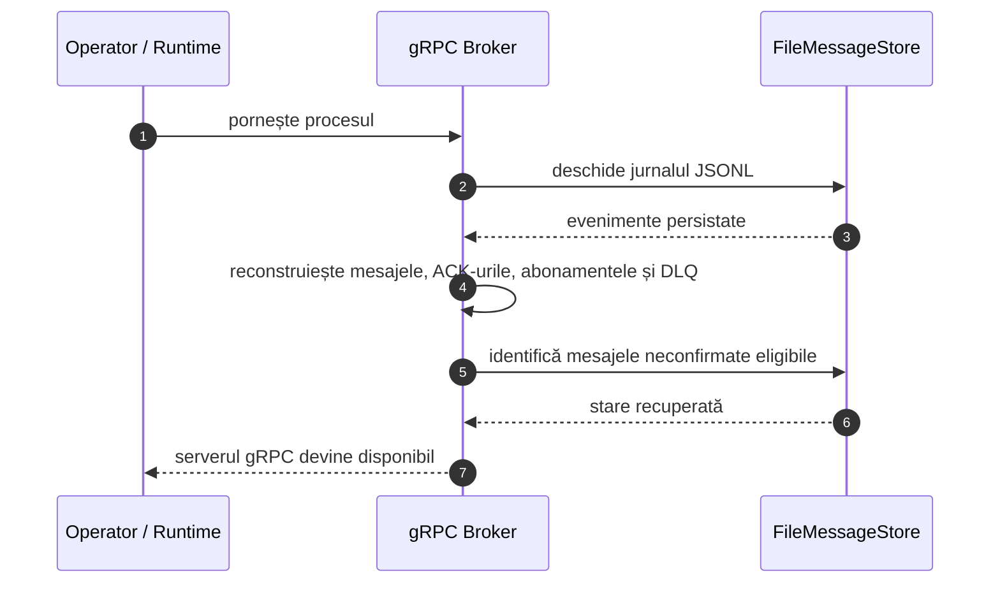
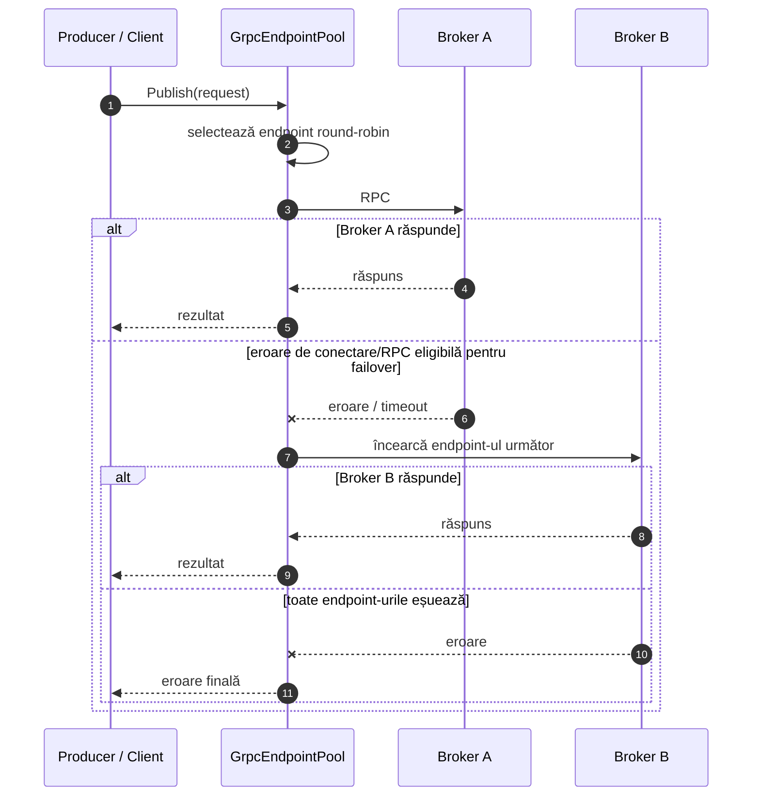
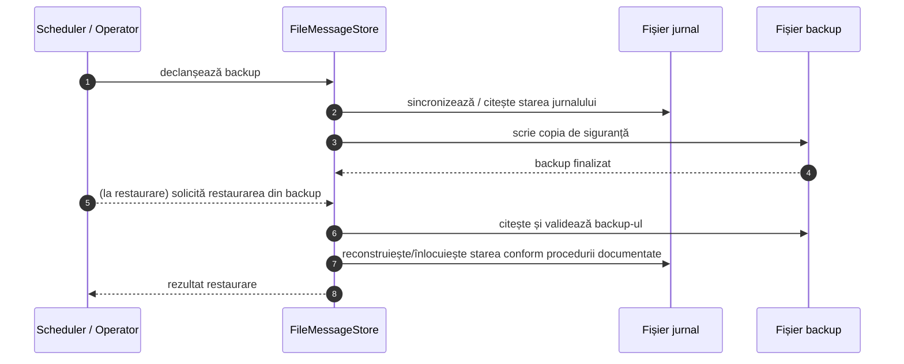
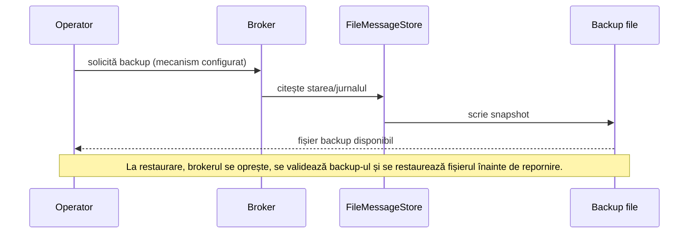
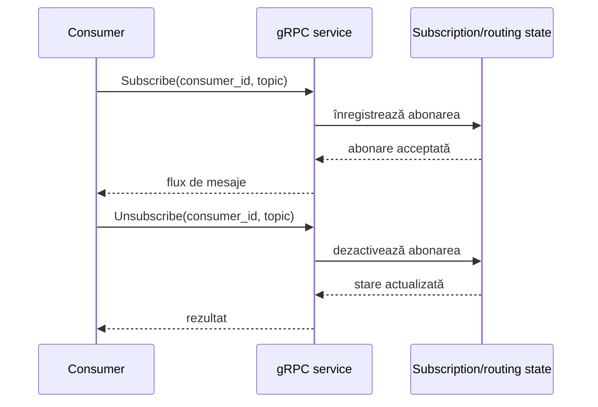

# Diagrame de secvență — implementarea gRPC

Aceste diagrame documentează fluxurile principale ale implementării. Ele descriu comportamentul arhitectural
intenționat; pentru predare, confruntați fiecare pas cu testele și comportamentul executat efectiv.

## 1. Publicarea și persistența mesajului

## 2. Consum, ACK/NACK, retry și DLQ

## 3. Recuperare după repornirea brokerului

## 4. Load balancing și failover la apelul RPC

**Limită:** failover-ul după un timeout poate repeta o cerere a cărei rezultat nu a ajuns la client. Deduplicarea după
ID reduce riscul pentru publicare, dar nu transformă sistemul într-o livrare exactly-once. Brokerii trebuie să
folosească jurnalul comun și blocări fiabile dacă împart aceeași stare.

## 5. Backup și restaurare

Backup-ul trebuie făcut într-un mod consistent cu scrierile concurente. Testați restaurarea pe o copie separată a
directorului de date, nu peste singura copie a jurnalului.

## 6. Backup și restaurare

## 7. Rutare și abonare

Aceste secvențe sunt modele de interacțiune. Verificați ca fiecare operație menționată să existe în contractul
`messaging.proto` și în implementare înainte de a o prezenta drept funcționalitate demonstrată.