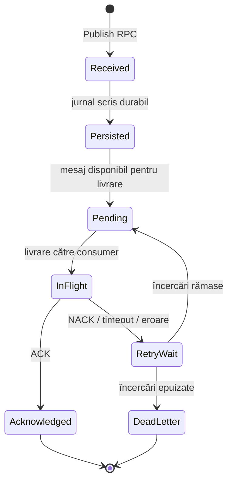

# Mașina de stări a unui mesaj



`RetryWait` presupune un mecanism de întârziere/backoff. Dacă implementarea curentă nu persistă termenul următoarei
încercări sau nu reia efectiv retry-ul după restart, această diagramă reprezintă comportamentul țintă și trebuie
ajustată după testarea codului.

```