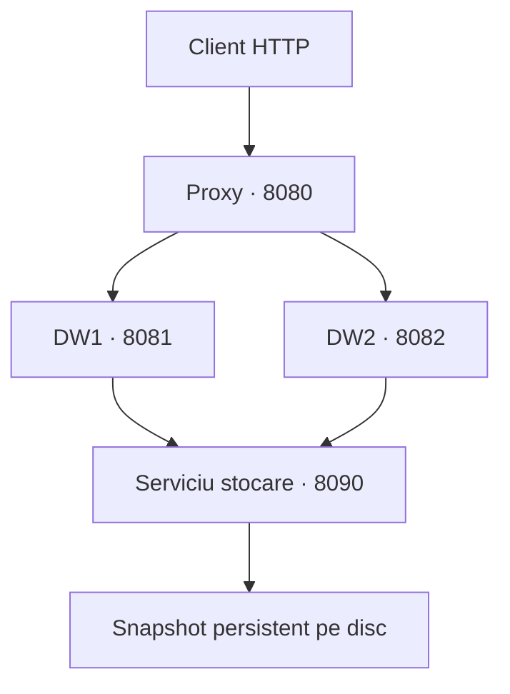

# Proiectul 3: Web Proxy

Proiect Java 17 pentru accesarea datelor despre angajați printr-un **reverse proxy HTTP**, cu cache, distribuire Round Robin, verificarea stării nodurilor, failover pentru citiri și sesiuni de client. Include două noduri DW independente și un serviciu comun de stocare persistentă și sincronizare a accesului. Aplicația folosește exclusiv bibliotecile standard Java; testele de integrare folosesc Python 3.

## Arhitectură



Fiecare dintre cele patru servicii rulează într-un **proces JVM separat**. Oprirea DW1 nu oprește DW2. Nodurile DW nu păstrează copii locale ale colecțiilor: ele accesează aceeași stare autoritativă prin serviciul de stocare, care serializează modificările și salvează un snapshot înainte de confirmare.

### Alegerea sincronizării

Am ales alternativa unui **serviciu comun de sincronizare și stocare**, în locul Cassandra. Aceasta permite demonstrarea proceselor independente, a datelor comune și a persistenței fără infrastructură externă. Operațiile `put` și `propose` sunt atomice în serviciu, iar citirile după confirmare văd aceeași versiune prin oricare DW, dacă nu sunt servite din cache.

Stocarea este un repository propriu cu fișier binar, nu o bază de date distribuită. Fișierul este scris temporar, sincronizat prin `FileChannel.force(true)` și înlocuit atomic. Un file lock împiedică pornirea a două servicii pe același fișier. Nu există replicare sau consens: serviciul de stocare este un punct unic de indisponibilitate. Alegerea și alternativele sunt explicate în `docs/decizii.md`.

## Funcționalități

- **Procese DW independente:** rolul, portul și identificatorul se primesc la pornire. Fiecare server are un pool de 32 de fire.
- **Date comune persistente:** angajații, propunerile și secvența propunerilor se păstrează după restartul serviciului de stocare.
- **GET / PUT / POST:** citire și paginare, creare sau înlocuire și înregistrarea unei propuneri. POST nu modifică direct angajatul confirmat.
- **JSON / XML:** negociere prin `Accept`, inclusiv ponderi `q` și wildcard-uri. Formatele nesuportate produc `406 Not Acceptable` înaintea unei scrieri.
- **Creare prin PUT:** `201 Created` și `Location` pentru un ID nou; `200 OK` pentru înlocuire. Decizia este atomică în repository.
- **Cache:** `GET /employees`, TTL implicit 5 secunde, maximum 1000 de intrări. Cheia include URI-ul și formatul negociat. `no-cache` sau `no-store` ocolesc cache-ul.
- **Invalidare fără lacăt de rețea:** generația se schimbă la începutul și sfârșitul fiecărei scrieri, inclusiv când aceasta eșuează. Cache-ul se golește în ambele momente. O citire este memorată numai dacă generația a rămas aceeași și nu există scrieri active.
- **Round Robin:** rotație numai între nodurile considerate sănătoase; un HIT nu consumă o poziție în rotație.
- **Health checks:** proxy-ul interoghează periodic `/health`; DW verifică și accesul la stocare. Un nod căzut este exclus și reintrodus după o verificare reușită.
- **Failover:** GET se reîncearcă pe următorul nod disponibil la eroare de transport sau răspuns 5xx. PUT și POST nu sunt retransmise automat: după o întrerupere rezultatul scrierii poate fi necunoscut.
- **Smart Proxy cu sesiuni:** cookie-ul `PADSESSION` identifică o sesiune creată de server. Proxy-ul folosește starea sesiunii pentru numărarea cererilor și logare; răspunsurile expun `X-Session-Id` și `X-Session-Requests`, inclusiv pentru HIT. Sesiunea continuă când cererile sunt distribuite către alt DW.
- **Conexiuni persistente:** HTTP/1.1 către client și reutilizarea aceleiași instanțe `HttpClient` către DW. Sesiunea aplicației este distinctă de conexiunea TCP.
- **Corelare:** `X-Correlation-Id` primit de la client este păstrat și trimis către DW; în lipsa lui se generează un UUID. Proxy-ul și fiecare DW îl includ în loguri.

### Garanții și limite

Nu se ține niciun monitor sau lacăt de cache în timpul unui apel de rețea. În timpul unei scrieri, citirile continuă către DW, dar nu sunt memorate. O citire care se suprapune cu o scriere poate primi starea anterioară; verificarea generației împiedică păstrarea acesteia în cache după scriere.

Invalidarea acoperă scrierile prin **acest proxy**. O scriere directă la DW sau printr-un alt proxy poate lăsa cache-ul vechi până la TTL. Pentru o demonstrație normală folosiți portul 8080. Un HIT valid poate fi servit și dacă DW-urile sunt momentan indisponibile.

Health checks reduc fereastra de indisponibilitate, dar nu o elimină: un nod poate cădea imediat după verificare. O scriere deja trimisă poate primi 502/503, fără retransmitere automată. Dacă nu există noduri sănătoase, cererile către backend primesc 503.

Sesiunile sunt în memoria proxy-ului: maximum 1000, expirare după 30 de minute de inactivitate, evacuarea celei mai vechi la atingerea limitei. Se pierd la restart; nu reprezintă autentificare și nu folosesc Redis. Nu există afinitate obligatorie între sesiune și DW.

Datele sunt persistente la restartul procesului, inclusiv după terminarea forțată verificată de teste. Nu se promite recuperare după defect fizic al discului sau întreruperea alimentării; nu există jurnal tranzacțional, backup automat sau replicare. Snapshot-ul complet și istoricul nelimitat al propunerilor sunt potrivite pentru volumul redus al laboratorului.

Toate serverele ascultă pe `127.0.0.1`. Protocolul intern al stocării este binar, fără deserializare de obiecte Java. Proiectul nu oferă autentificare sau TLS și este destinat demonstrației locale.

## Cerințe și rulare

Necesită **JDK 17+** (`java` și `javac`). Python 3 este necesar numai pentru teste. Maven este opțional pentru compilare și importul în IntelliJ.

Puneți `web-proxy-lab` în același proiect cu `grpc-service-communication` și `MessagingAgent`. Din terminalul IntelliJ:

```bash
cd web-proxy-lab
bash scripts/start-all.sh
```

Scriptul compilează și pornește **patru JVM-uri separate**, afișează PID-urile și scrie logurile în `logs/`. Așteptați câteva secunde pentru health checks. `Ctrl+C` oprește procesele pornite de acest script. Datele rămân în `data/store.bin`.

### Pornire în patru terminale

Compilați o singură dată, din folderul `web-proxy-lab`:

```bash
bash scripts/build.sh
```

Apoi executați fiecare comandă într-un terminal separat, din același folder:

```bash
java -cp target/classes md.utm.pad.Main storage 8090 data/store.bin
```

```bash
java -cp target/classes md.utm.pad.Main dw 8081 dw-1
```

```bash
java -cp target/classes md.utm.pad.Main dw 8082 dw-2
```

```bash
java -cp target/classes md.utm.pad.Main proxy 8080
```

În IntelliJ se pot crea patru configurații **Application**, toate cu clasa `md.utm.pad.Main`, dar cu argumentele de mai sus: `storage ...`, `dw ...`, `dw ...`, `proxy ...`. Working directory trebuie să fie folderul modulului. Fișierul `pom.xml` permite importarea modulului Maven; compilarea Maven se face cu `mvn compile`.

### Configurare

| Variabilă / argument | Valoare implicită | Rol |
|---|---|---|
| Primul argument | obligatoriu: `storage`, `dw` sau `proxy` | Selectarea procesului |
| Al doilea argument / `PORT` | 8090 storage, 8081 DW, 8080 proxy | Portul procesului |
| Al treilea argument storage / `STORE_FILE` | `data/store.bin` | Fișier persistent |
| Al treilea argument DW / `NODE_ID` | `dw-<port>` | Identificator DW |
| `STORE_URL` | `http://127.0.0.1:8090` | Serviciul folosit de fiecare DW |
| `DW_ENDPOINTS` | `http://127.0.0.1:8081,http://127.0.0.1:8082` | Lista nodurilor proxy |
| `CACHE_TTL_MS` | 5000 | TTL cache în milisecunde |
| `HEALTH_INTERVAL_MS` | 1000 | Pauza între rundele de verificare |

Argumentele explicite au prioritate față de variabilele de mediu. Fiecare verificare de sănătate are timeout de 700 ms; o rundă verifică nodurile secvențial. Apelurile proxy către DW au timeout de 5 secunde.

## API

| Metodă și rută | Comportament |
|---|---|
| `GET /employees` | Lista angajaților; `offset` și `limit` opționale |
| `GET /employees?id=1` | Un angajat sau 404 |
| `PUT /employees` | Creează (201) sau înlocuiește (200) |
| `POST /employees` | Înregistrează o propunere (202) |
| `GET /updates/employees?after=0` | Propunerile cu secvență mai mare decât cursorul |
| `GET /health` | Disponibilitatea procesului și a dependenței sale |

PUT și POST folosesc `Content-Type: application/x-www-form-urlencoded`, de exemplu `id=4&name=Alexandra`. ID-ul trebuie să fie pozitiv; numele are 1–100 de caractere, fără caractere de control. JSON/XML se aplică reprezentărilor de date returnate. Erorile și confirmarea POST sunt mesaje text.

Propunerile nu sunt consumate de GET. Sursa urmărește cursorul `after`, apoi publică prin PUT modificarea acceptată; acest rol este demonstrat cu `curl` și teste, fără un client de sincronizare automat.

## Teste automate

Din folderul modulului:

```bash
bash scripts/test.sh
```

Scriptul compilează sursele și rulează suita `unittest` din `tests/test_integration.py`. Nu necesită pachete Python externe. Testele pornesc procese Java reale pe porturi temporare și folosesc fișiere temporare; nu modifică `data/store.bin`.

Scenarii acoperite:

- MISS, HIT, expirare și invalidare după PUT;
- răspunsuri 201/200, `Location`, JSON/XML, 406 și validarea intrărilor;
- Round Robin și PID-uri distincte;
- căderea unui DW, failover GET, scriere prin nodul sănătos și reintegrare;
- indisponibilitatea tuturor DW-urilor;
- date comune și persistență după oprirea forțată a serviciului de stocare;
- propagarea correlation ID în loguri, sesiuni și keep-alive client–proxy;
- POST, pull, persistența propunerilor și confirmare;
- cereri concurente;
- scriere lentă care nu blochează citirea;
- citire veche finalizată după scriere, care nu poate repopula cache-ul.

**Comanda de testare este `bash scripts/test.sh`.** `mvn test` nu execută această suită Python. Raportul verificării efectuate pentru arhivă este în `docs/rezultate-teste.txt`.

## Demonstrație pentru prezentare

### Cache și invalidare

```bash
curl -i http://127.0.0.1:8080/employees
curl -i http://127.0.0.1:8080/employees
curl -i -X PUT -d 'id=4&name=Alexandra' http://127.0.0.1:8080/employees
curl -i http://127.0.0.1:8080/employees
```

Primele două cereri, într-un interval mai mic de 5 secunde: MISS, apoi HIT. PUT: 201 dacă ID-ul este nou, altfel 200. Următorul GET este MISS și include datele actualizate.

### Alternare, cădere și revenire

```bash
for i in 1 2 3 4; do
  curl -s -D - -o /dev/null -H 'Cache-Control: no-cache' http://127.0.0.1:8080/employees
done
```

Observați `X-Warehouse: dw-1`, apoi `dw-2`. Opriți numai procesul DW1 (`Ctrl+C` în terminalul lui sau `kill <PID-DW1>` dacă folosiți scriptul comun). Așteptați câteva secunde, apoi repetați: toate cererile ajung la DW2. Testați și un PUT. Reporniți DW1; health check îl reintroduce automat în rotație.

### Sesiune și corelare

```bash
curl -i -c /tmp/pad-cookies.txt -H 'X-Correlation-Id: demo-profa-1' \
  -H 'Cache-Control: no-cache' http://127.0.0.1:8080/employees
curl -i -b /tmp/pad-cookies.txt -c /tmp/pad-cookies.txt \
  -H 'Cache-Control: no-cache' http://127.0.0.1:8080/employees
```

`X-Session-Id` rămâne același și `X-Session-Requests` crește. În logul DW apare `correlation=demo-profa-1`. Pentru a vedea conexiunea persistentă:

```bash
curl --http1.1 -v http://127.0.0.1:8080/employees http://127.0.0.1:8080/employees
```

### Persistență și formate

După un PUT, opriți și reporniți serviciile folosind același `STORE_FILE`: angajatul rămâne prezent. Nu ștergeți folderul `data/` între porniri.

```bash
curl -i -H 'Accept: application/xml' http://127.0.0.1:8080/employees
curl -i -H 'Accept: text/csv' http://127.0.0.1:8080/employees
```

A doua cerere trebuie să primească `406 Not Acceptable`.

## Structura codului

| Fișier | Responsabilitate |
|---|---|
| `Main.java` | Selectarea rolului, configurarea și ciclul de viață al procesului |
| `EmployeeStore.java` | Contractul repository-ului și tipurile de date |
| `PersistentEmployeeStore.java` | Stare autoritativă, atomicitate și snapshot pe disc |
| `StorageController.java` | Protocolul intern al serviciului comun |
| `RemoteEmployeeStore.java` | Client HTTP folosit de DW pentru acces la stocare |
| `WarehouseController.java` | API pentru angajați, formate, validare, health și logare |
| `ProxyController.java` | Cache, generații, Round Robin, health checks, failover și sesiuni |
| `HttpUtil.java` | Serializare, negociere Accept și corelare |

Arhiva nu include `.class`, `target/` sau date generate. Acestea se creează local la compilare și rulare.
