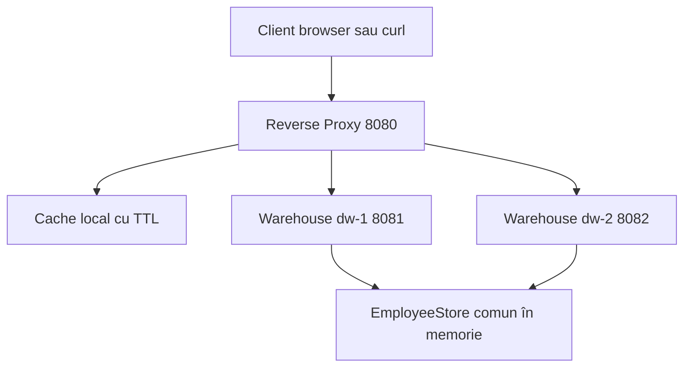

# Proiectul 3: Web Proxy

Proiect Java pentru intermedierea comunicării Client–Data Warehouse printr-un **reverse proxy HTTP**. Include răspunsuri **JSON/XML**, procesarea concurentă a cererilor, cache cu expirare, distribuirea cererilor prin **Round Robin**, reutilizarea conexiunilor HTTP și identificatori de corelare. Datele gestionate sunt angajați, iar modificările pot fi publicate direct sau propuse pentru confirmare prin mecanismul pull.

## Arhitectură



Clientul accesează proxy-ul pe portul `8080`. La o cerere care necesită acces la backend, proxy-ul selectează unul dintre nodurile DW și transmite răspunsul acestuia clientului. La un cache HIT, răspunsul este returnat direct din cache.

Cele trei servere HTTP sunt pornite de `Main` în aceeași JVM. Nodurile DW folosesc aceeași instanță `EmployeeStore`, protejată prin metode `synchronized`.

Sursele se află în `src/main/java/md/utm/pad/`:

- `Main.java` — inițializarea și oprirea serverelor și a pool-urilor de fire.
- `EmployeeStore.java` — stocarea angajaților și a propunerilor de modificare.
- `WarehouseController.java` — prelucrarea cererilor HTTP asupra datelor.
- `ProxyController.java` — intermediere, cache, Round Robin și corelare.
- `HttpUtil.java` — parametri query, răspunsuri HTTP și reprezentări JSON/XML.

## Funcționalități

- **Comunicare HTTP:** GET pentru consultare, PUT pentru publicarea datelor și POST pentru propuneri de modificare.
- **JSON/XML:** formatul datelor returnate este selectat prin antetul `Accept`.
- **Procesare concurentă:** fiecare server utilizează un pool de 32 de fire; fiecare cerere activă este procesată de un fir.
- **Acces sincronizat:** operațiile repository-ului protejează colecțiile comune împotriva accesului simultan necontrolat.
- **Cache temporar:** răspunsurile cu status 200 la `GET /employees` sunt memorate pentru 5 secunde. Cheia include URI-ul cu parametrii query și valoarea `Accept`.
- **Invalidare:** cache-ul este golit după primirea unui răspuns la PUT sau POST prin proxy. Un lock citire/scriere coordonează accesul și invalidarea.
- **Load balancing:** contor atomic pentru selecția Round Robin între `dw-1` și `dw-2`. Cererile rezolvate din cache nu determină o nouă selecție.
- **Conexiuni și corelare:** HTTP keep-alive către client și un `HttpClient` reutilizat către DW. Fiecare cerere primește un UUID; registrul `inFlight` păstrează temporar contextul clientului, iar `HttpExchange` păstrează legătura cu răspunsul.
- **Pull pentru modificări:** sursa citește propunerile folosind un cursor `after` și publică starea acceptată prin PUT. Rolul sursei este executat manual prin cereri HTTP.
- **Gestionarea erorilor:** validare, timeout de conectare de 2 secunde și timeout pe cerere de 5 secunde. La erori de transport pentru GET, proxy-ul încearcă și celălalt DW; scrierile nu sunt repetate automat.

### Garanții și limite

Datele, propunerile și cache-ul sunt păstrate **în memorie** și se pierd la restart. Cele două DW sunt servere HTTP distincte în același proces, nu procese independente. Distribuirea pe calculatoare diferite necesită adaptarea stocării sau sincronizarea datelor. Cassandra și Redis nu sunt incluse.

Scrierile directe către DW ocolesc invalidarea cache-ului. O eroare de transport la scriere poate lăsa rezultatul operației necunoscut și cache-ul neschimbat până la expirare. Limita cache-ului este de aproximativ 1000 de intrări; la atingerea ei, cache-ul este golit, fără politică LRU.

Registrul `inFlight` urmărește cererile active, fără sesiuni persistente sau asocierea unui client cu un DW fix. Aplicația ascultă doar pe loopback și nu include autentificare. Selecția JSON/XML este simplificată: XML dacă `Accept` conține `application/xml`, JSON în rest; ponderile de negociere `q` nu sunt interpretate.

## Cerințe și rulare

Necesită **JDK 17+**, inclusiv `javac`. Aplicația folosește API-uri din JDK, fără biblioteci externe. Porturile `8080`, `8081` și `8082` trebuie să fie libere.

Din rădăcina repository-ului:

```bash
cd web-proxy-lab
bash scripts/run.sh
```

Scriptul compilează sursele în `target/classes` și pornește `md.utm.pad.Main`. Oprirea se face cu `Ctrl+C`.

În IntelliJ IDEA, importați `web-proxy-lab/pom.xml` prin **Add as Maven Project**, configurați JDK 17+ și rulați metoda `main` din `Main.java`. Modulul poate fi deschis în același proiect cu celelalte laboratoare.

### Configurare

Valorile curente sunt definite în cod; nu există încă variabile de mediu pentru configurare.

| Parametru | Valoare | Clasă |
|---|---|---|
| Adresă de ascultare | `127.0.0.1` | `Main` |
| Port proxy | `8080` | `Main` |
| Porturi DW | `8081`, `8082` | `Main`, `ProxyController` |
| Fire per server | `32` | `Main` |
| TTL cache | `5 secunde` | `ProxyController` |
| Prag cache | Aproximativ `1000` intrări | `ProxyController` |
| Timeout conectare | `2 secunde` | `ProxyController` |
| Timeout cerere | `5 secunde` | `ProxyController` |

## API

Adresa utilizată de client: `http://localhost:8080`.

| Metodă | Rută | Operație |
|---|---|---|
| GET | `/employees` | Lista angajaților |
| GET | `/employees?id=1` | Căutare după id |
| GET | `/employees?offset=1&limit=2` | Paginare în ordinea id-urilor |
| PUT | `/employees` | Adăugare sau înlocuire angajat |
| POST | `/employees` | Înregistrare propunere de modificare |
| GET | `/updates/employees?after=0` | Citirea propunerilor după cursor |
| GET | `/health` | Răspuns de disponibilitate de la DW selectat |

Scrierile folosesc `application/x-www-form-urlencoded`, de exemplu `id=4&name=Alexandra`. Id-ul trebuie să fie pozitiv, iar numele să aibă între 1 și 100 de caractere după eliminarea spațiilor de la capete, fără caractere de control. Corpul cererii este limitat la 8192 de octeți.

POST răspunde cu `202` și un număr `sequence`, fără a modifica angajatul confirmat. GET updates nu consumă propunerile; sursa urmărește cursorul și confirmă modificarea prin PUT.

### Antete de diagnostic

- `X-Cache: MISS` — răspuns obținut de la DW pentru o citire eligibilă pentru cache.
- `X-Cache: HIT` — răspuns returnat din cache.
- `X-Cache: BYPASS` — cache ocolit.
- `X-Warehouse` — nodul care a generat răspunsul, inclusiv sursa copiei memorate la HIT.
- `X-Correlation-Id` — identificator unic al cererii către proxy.

`Cache-Control: no-cache` în cerere ocolește cache-ul intern. `Cache-Control: no-store` în răspuns cere clientului să nu păstreze propria copie.

## Verificare înainte de predare

Porniți aplicația și executați cererile din `requests.http` sau comenzile de mai jos într-un terminal separat.

### JSON și XML

```bash
curl -i -H 'Accept: application/json' http://localhost:8080/employees
curl -i -H 'Accept: application/xml' http://localhost:8080/employees
```

Rezultat așteptat: aceeași listă în cele două formate.

### Cache și expirare

```bash
sleep 6
curl -i -H 'Accept: application/json' http://localhost:8080/employees
curl -i -H 'Accept: application/json' http://localhost:8080/employees
sleep 6
curl -i -H 'Accept: application/json' http://localhost:8080/employees
```

Rezultat așteptat: **MISS → HIT → MISS**. Primele două cereri trebuie executate la mai puțin de 5 secunde distanță.

### Round Robin

```bash
for i in 1 2 3 4; do
  curl -s -D - -o /dev/null \
    -H 'Cache-Control: no-cache' http://localhost:8080/employees
done
```

Rezultat așteptat: `BYPASS` și alternarea `dw-1` / `dw-2`. Nodul inițial depinde de cererile anterioare; alte cereri simultane pot modifica ordinea observată.

### Conexiune persistentă client–proxy

```bash
curl --http1.1 -v \
  -H 'Cache-Control: no-cache' \
  http://localhost:8080/employees \
  http://localhost:8080/employees \
  http://localhost:8080/employees
```

Rezultat așteptat: mesajul `Re-using existing connection with host localhost` sau echivalentul său pentru versiunea curl folosită.

### PUT și invalidarea cache-ului

```bash
curl -i -X PUT -d 'id=4&name=Alexandra' http://localhost:8080/employees
curl -i 'http://localhost:8080/employees?id=4'
curl -i 'http://localhost:8080/employees?id=4'
curl -i -X PUT -d 'id=4&name=Alexandra%20Manea' http://localhost:8080/employees
curl -i 'http://localhost:8080/employees?id=4'
```

La executarea consecutivă, cele două citiri din mijloc produc MISS și HIT. Citirea finală produce MISS și numele actualizat.

### POST și pull

```bash
curl -i -X PUT -d 'id=4&name=Alexandra' http://localhost:8080/employees
curl -i -X POST -d 'id=4&name=Alexandra%20Manea' http://localhost:8080/employees
curl -i 'http://localhost:8080/updates/employees?after=0'
curl -i 'http://localhost:8080/employees?id=4'
curl -i -X PUT -d 'id=4&name=Alexandra%20Manea' http://localhost:8080/employees
curl -i 'http://localhost:8080/employees?id=4'
```

După POST, numele confirmat rămâne `Alexandra`. După PUT-ul de confirmare, devine `Alexandra Manea`.

### Cereri concurente

```bash
seq 1 20 | xargs -P 8 -I '{}' curl -s -o /dev/null \
  -w '%{http_code}\n' -H 'Cache-Control: no-cache' \
  http://localhost:8080/employees
```

Rezultat așteptat: 20 de răspunsuri cu status `200`, folosind până la 8 procese curl simultane. Această verificare este funcțională, nu un benchmark de performanță.

### Starea verificărilor

Au fost confirmate manual răspunsurile JSON/XML, cache MISS–HIT, expirarea cache-ului, alternarea nodurilor și reutilizarea conexiunii client–proxy. Scenariile PUT, POST/pull și concurență sunt incluse pentru verificare, fără a fi declarate teste trecute. Proiectul nu conține o suită de teste automate.

## Documentație

- Diagrama de arhitectură este inclusă în acest README și se afișează pe GitHub prin Mermaid.
- `requests.http` conține exemple de cereri pentru API.
- `scripts/run.sh` compilează și pornește aplicația.
